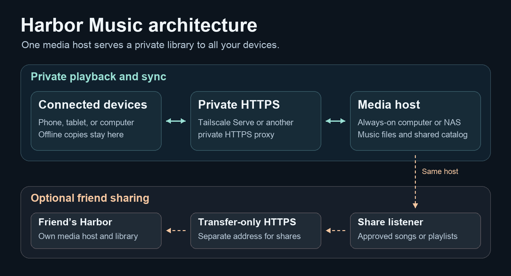

# Harbor Music design

Harbor Music lets someone run a private music library from audio files they already have. An always-on Mac or Linux computer can be the **media host**, with its music and catalog on local disk. A compatible NAS can also serve as the media host. Each installation has its own catalog, device pairings, and playlists. For setup commands, see the [installation guide](README.md).

## Scope

The design serves one owner and their devices. Someone starting fresh supplies a music folder and an available host. Harbor builds the catalog on its first scan.

- Browse by title, artist, album, and genre. Fetch library results in pages and render the visible rows. Play in order or shuffle across the full current selection.
- Sync Favorites and chosen playlists across paired devices. Keep device-only playlists locally. Let devices manage offline copies independently.
- Remember the last song and position on each device and hand off playback across devices. Retry interrupted playback and queued edits when the host returns.
- Optionally transfer selected songs or an ordered playlist to an approved friend’s Harbor. The recipient imports their own copy.

Photo and video management, public library browsing, individual profiles on one server, server-side transcoding, and migration from a mixed-media database are outside the project scope.

## First use

1. Start Harbor on the computer that can read your music folder. Keep the media host awake and connected to the network while it serves your library.
2. Give the player a private HTTPS address with Tailscale Serve or another private HTTPS proxy. Once that address is reachable, open **Devices** on the media host and generate a pairing code.
3. Open that same address on each device and pair it. Use the browser, add the player to the Home Screen on iPhone or iPad, or build the Mac app against that address.
4. Create a synced playlist, favorite a song, or start listening. Another paired device can open the same playlist and pick up the shared playback position. Choose downloads independently on each device.

## Components and network boundaries

| Component | Role |
| --- | --- |
| Music directory | Holds the original audio files. A background scanner reads metadata with `ffprobe`, using `Artist/Album/Track` and the filename as fallbacks. |
| SQLite catalog | Stores track metadata, Favorites, synced playlists, device records, the playback bookmark, and sharing records. Keep it on the Harbor host’s local disk. |
| Local owner player, `127.0.0.1:18765` | Has the music player and the **Connected devices** controls to issue pairing codes and revoke devices. Trust is based on access to the media host. Keep this listener out of all reverse proxies and public tunnels. |
| Paired player, `127.0.0.1:8765` | Serves the browser app and music API behind private HTTPS. Pairing is required for catalog data, audio, and mutations. Tailscale Serve is one way to supply private HTTPS. |
| Transfer listener, `127.0.0.1:8766` | Runs only when outbound sharing is configured. A separate HTTPS origin serves invitations and transfers authorized for a specific friend. |
| Browser and Mac app | Run the same player and maintain their own offline app shell, audio downloads, local playlists, and pending edits. The native Mac window is bound to a single private HTTPS origin. |

All three listeners bind to loopback. The reverse proxy terminates TLS and preserves `Host`. Route private HTTPS to the paired player and any public transfer traffic only to the transfer listener. Its route allowlist limits what an outside visitor can reach. The operator chooses the network provider and runs the catalog and music storage locally.

## Where data lives

| Data | Storage and behavior |
| --- | --- |
| Original music | The music folder on the host or its mounted storage. The player streams the original format and uses HTTP byte ranges for seeking. |
| Shared library state | The host’s SQLite catalog holds Favorites, synced playlists, and the shared playback bookmark. Changes become available to the other paired devices. |
| Device state | IndexedDB holds device-only playlists, download selections, and queued edits. Local storage holds the playback bookmark. The service worker caches the player shell, and downloaded audio lives in the device’s Cache Storage. |
| Sharing state | Each participating installation stores its own identity and sharing records. Incoming audio is staged on the recipient’s host and imported into their configured folder. |

## Catalog and synchronization

The scanner walks supported audio filenames and skips hidden files and symlinks. With `ffprobe` installed, it reads tags from new or changed files. It can also use filenames and folder names. Track IDs are derived from canonical file paths. Replacing a track at the same path keeps its ID. Moving it creates a new catalog entry. A successful scan marks missing files unavailable and keeps the playlist entries and Favorites that reference them. Use the mount check for removable or network storage.

Pairing codes are single-use, expire after five minutes, and have a bounded number of attempts. The paired player uses a `Secure`, `HttpOnly`, `SameSite=Strict` cookie. The server stores a hash of the device token. Paired devices share access to one library and its synced state. Revoke a lost device in the owner player. Revocation cuts off server access, while audio already downloaded to that device may still be present.

Playlist writes carry the revision they started from. If another device changes the playlist first, Harbor keeps the current server version and saves conflicting edits as a local copy. Offline writes retry after reconnect. Download settings belong to the browser installation. Automatic copies track the lists that require them, so removing one source removes only downloads with no remaining source or manual save.

The shared playback bookmark records the track, position, and playback intent. A generation and writer sequence give the active device control and reject stale writes. During an outage the player can use a local bookmark or a downloaded file. When the connection returns, it retries at the last position when the browser allows. Mobile background execution, autoplay, codec support, and offline storage retention depend on the browser and operating system.

## Friend sharing

Sharing starts disabled. A sender can make the dedicated transfer origin reachable to friends outside their private network. The friend opens their own private Harbor, and their player requests approved files from that transfer origin. Each person continues to use their own network and installation.

1. The sender creates an invitation and sends it to a friend. The friend opens it in their own Harbor. Both sides see a phrase to compare before the sender approves the recipient’s installation key.
2. The sender chooses that friend and a song or playlist. Harbor creates a signed file manifest and a share link. Download requests require proof from the approved recipient’s key.
3. The receiving player requests chunks and passes them to its Harbor server for verification and import. An interrupted transfer can resume. When the sender receives the signed import receipt, Harbor closes the offer. The imported audio becomes the recipient’s local copy.

Share limits are 128 tracks, 64 MiB per track, 512 MiB per offer, and a three-day lifetime. Staged transfers and the installation key live on the recipient’s host. Keep the key and catalog private. Revoking a friend ends their pending shares.

## Operation and recovery

Run Harbor as an unprivileged host user under a service manager if you want it to restart after a crash or boot. Give it read access to music, write access to its local state, and write access to the designated import folder when receiving shares. Use a stable private HTTPS origin. Switching origins creates a new browser cookie and offline store, so pair again and reselect downloads as needed.

Back up music including imported files, and back up the complete Harbor state directory. A backup made with Harbor stopped captures the SQLite files and sharing identity together. Keep the same music and import paths when restoring. Browser-only playlists and offline audio live on each device and are outside a host backup. Start a clean installation with a new state directory, or use the adoption tool with a compatible music-only NAS catalog. Adoption adds the standalone schema fields and leaves existing track IDs, device identities, and playlist references in place.

## Verification

| Scenario | Expected result |
| --- | --- |
| Index a fresh local music folder | A computer with local disk storage can index and stream tracks from a new catalog. |
| Pair two devices | Both can stream, edit synced playlists, and resume from the shared bookmark. Unpaired devices cannot read the catalog or stream audio. |
| Interrupt the network or restart the host | The player can use available downloads, then reconnect and send queued edits. A recoverable stream resumes at its saved position. |
| Enable transfers for two installations | An approved recipient can resume a transfer and import it once. The transfer address rejects private library routes. |
| Play from a physical iPhone | Check Safari and the Home Screen app through a lock-screen pause and skip, a network switch, and reopening after the OS suspends the app. |

The repository includes synthetic libraries and browser regression tests. See the [test commands](README.md#development).
